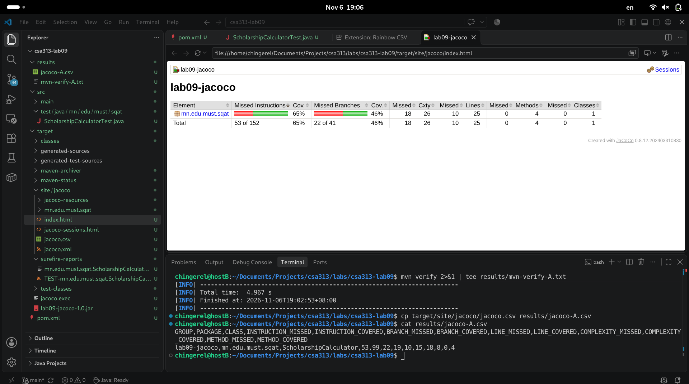
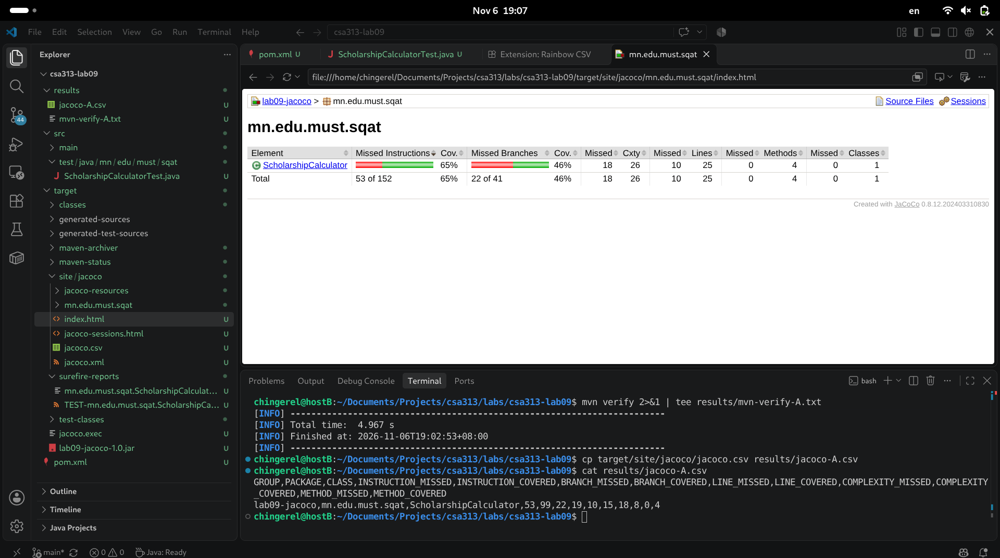
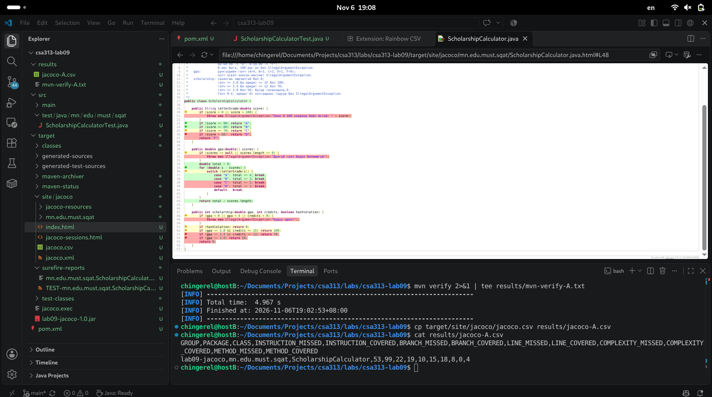
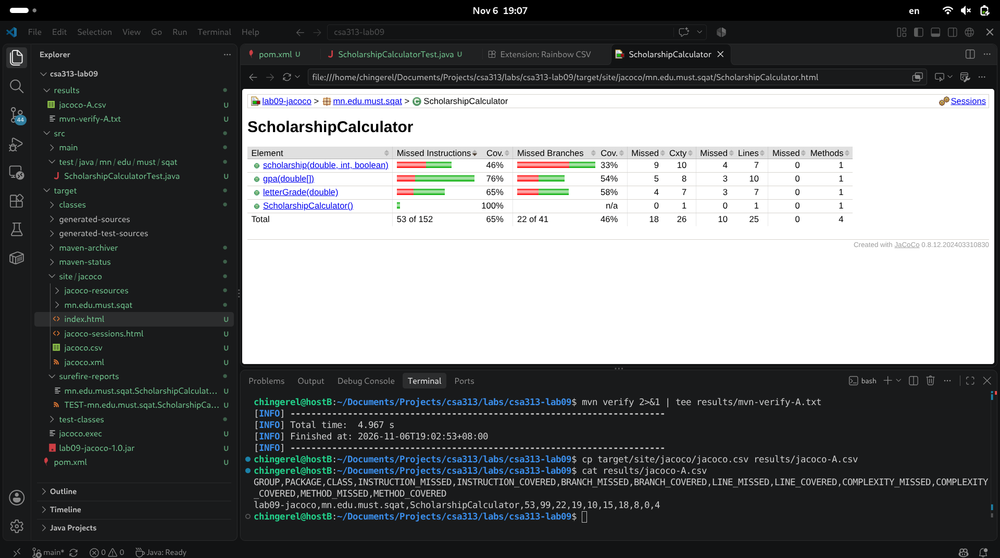
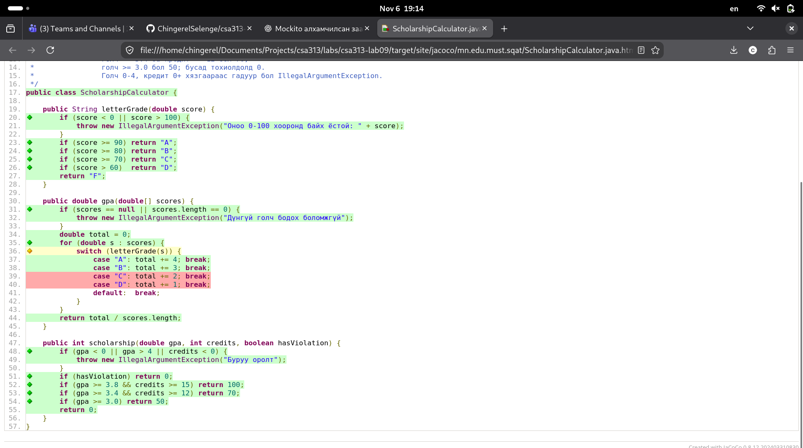
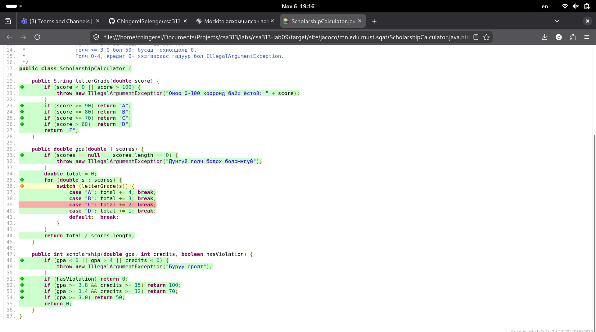
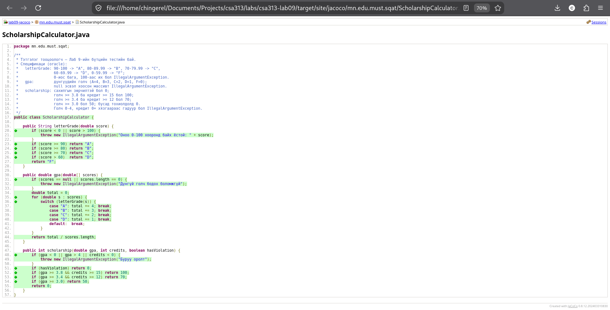

# Лаборатори №9 — Код хамралт (JaCoCo)

**Хичээл:** F.CSA313 — Программ хангамжийн чанарын баталгаа ба тест  
**Оюутны нэр:** С.Чингэрэл  
**Оюутны код:** B232270010  
**Сэдэв:** JaCoCo ашиглан кодын хамралтыг хэмжих, бүтцийн тест болон хилийн утгын тест боловсруулах

---

## 1. Лабораторийн зорилго

Энэхүү лабораторийн ажлын зорилго нь JaCoCo хэрэгслийг ашиглан Java програмын кодын хамралтыг хэмжих, Line Coverage болон Branch Coverage үзүүлэлтүүдийг ойлгох, тестийн тохиолдлуудыг нэмэх замаар кодын бүх мөр болон нөхцөлт салааллыг шалгахад оршино.

Мөн 100% Branch Coverage болсон ч хилийн утгын алдаа илрэхгүй үлдэж болохыг туршилтаар баталж, Boundary Value Testing ашиглан алдааг илрүүлэн зассан.

## 2. Ашигласан орчин, технологи

- Programming Language: Java
- Build Tool: Apache Maven
- Testing Framework: JUnit 5
- Code Coverage Tool: JaCoCo 0.8.12
- Operating System: Debian GNU/Linux
- IDE / Editor: Terminal, Nano
- Version Control: Git, GitHub

### Java version

Терминалд ажиллуулсан `java -version` командын бүтэн үр дүн:

```text
openjdk version "21.0.13" 2026-10-20
OpenJDK Runtime Environment (build 21.0.13+9-1-deb13u2-Debian)
OpenJDK 64-Bit Server VM (build 21.0.13+9-1-deb13u2-Debian, mixed mode, sharing)
```

### Maven version

Терминалд ажиллуулсан `mvn -version` командын бүтэн үр дүн:

```text
Apache Maven 3.9.9
Maven home: /usr/share/maven
Java version: 21.0.13, vendor: Debian, runtime: /usr/lib/jvm/java-21-openjdk-amd64
Default locale: en_US, platform encoding: UTF-8
OS name: "linux", version: "6.12.115+deb13.1-amd64", arch: "amd64", family: "unix"
```

### Maven dependencies

- JUnit Jupiter 5.10.2
- JaCoCo Maven Plugin 0.8.12
- Maven Surefire Plugin 3.2.5
- Java Compiler Release 17

## 3. Төслийн бүтэц

```text
csa313-lab09/
│
├── pom.xml
├── .gitignore
├── README.md
├── cfg.png
│
├── src/
│   ├── main/
│   │   └── java/
│   │       └── mn/
│   │           └── edu/
│   │               └── must/
│   │                   └── sqat/
│   │                       └── ScholarshipCalculator.java
│   │
│   └── test/
│       └── java/
│           └── mn/
│               └── edu/
│                   └── must/
│                       └── sqat/
│                           └── ScholarshipCalculatorTest.java
│
└── results/
    ├── mvn-verify-A.txt
    ├── jacoco-A.csv
    ├── mvn-verify-B.txt
    ├── jacoco-B.csv
    ├── mvn-verify-C.txt
    ├── jacoco-C.csv
    ├── mvn-test-D-fail.txt
    ├── mvn-verify-final.txt
    └── jacoco-final.csv
```

## 4. Тестийн объект — ScholarshipCalculator

`ScholarshipCalculator` класс нь дараах гурван үндсэн функцтэй.

### 4.1 letterGrade(score)

Оюутны оноог үсгэн үнэлгээнд хөрвүүлнэ.

| Онооны интервал | Үнэлгээ |
|---|---|
| 90–100 | A |
| 80–89.99 | B |
| 70–79.99 | C |
| 60–69.99 | D |
| 0–59.99 | F |

0-ээс бага эсвэл 100-аас их оноо өгсөн тохиолдолд `IllegalArgumentException` үүсгэнэ.

### 4.2 gpa(scores)

Оюутны авсан үнэлгээнүүдэд үндэслэн голч дүнг тооцоолно.

| Үнэлгээ | Голчийн оноо |
|---|---:|
| A | 4 |
| B | 3 |
| C | 2 |
| D | 1 |
| F | 0 |

`null` эсвэл хоосон массив өгсөн тохиолдолд `IllegalArgumentException` үүсгэнэ.

### 4.3 scholarship(gpa, credits, hasViolation)

Оюутны голч дүн, кредит болон сахилгын зөрчилд үндэслэн тэтгэлгийн хувийг тооцоолно.

| Нөхцөл | Тэтгэлэг |
|---|---:|
| Сахилгын зөрчилтэй | 0% |
| GPA ≥ 3.8 ба credits ≥ 15 | 100% |
| GPA ≥ 3.4 ба credits ≥ 12 | 70% |
| GPA ≥ 3.0 | 50% |
| Бусад тохиолдолд | 0% |

GPA 0–4 хязгаараас гадуур эсвэл кредит сөрөг бол `IllegalArgumentException` үүсгэнэ.

---

## 5. Part A — Initial Coverage

Эхний шатанд програмын хэвийн ажиллагааг шалгах 5 тест боловсруулсан.

Тестүүд:

1. `letterGrade_A()` — A үнэлгээ шалгах.
2. `letterGrade_B()` — B үнэлгээ шалгах.
3. `letterGrade_C()` — C үнэлгээ шалгах.
4. `gpa_NormalScores()` — хэд хэдэн дүнгийн голч бодох.
5. `scholarship_100Percent()` — 100 хувийн тэтгэлэг шалгах.

### 5.1 Тестийн үр дүн

```text
Tests run: 5, Failures: 0, Errors: 0, Skipped: 0
BUILD SUCCESS
```

### 5.2 JaCoCo анхны хамралт

`results/jacoco-A.csv` файлын бодит үзүүлэлт:

| Үзүүлэлт | Covered | Missed | Coverage |
|---|---:|---:|---:|
| Instructions | 99 | 53 | 65.13% |
| Branches | 19 | 22 | 46.34% |
| Lines | 15 | 10 | 60.00% |

### 5.3 Ажиглалт

Эхний 5 тестээр програмын хэвийн ажиллагааны замуудыг шалгасан. Гэвч буруу оролт, exception үүсгэх нөхцөл болон зарим нөхцөлт салааллууд хамрагдаагүй тул Line Coverage 60%, Branch Coverage 46.34% гарсан. JaCoCo тайланд хамрагдаагүй мөрүүд улаан, хэсэгчлэн хамрагдсан салааллууд шар өнгөөр харагдсан.

### JaCoCo анхны тайлан







---

## 6. Part B — 100% Branch Coverage ба Line Coverage

Энэ хэсэгт `letterGrade()`, `gpa()`, `scholarship()` функцүүдийн бүх нөхцөлт салаалал болон кодын мөрүүдийг шалгах нэмэлт тестүүд боловсруулсан.

### 6.1 Нэмсэн тестүүд

- Оноо 0-ээс бага байх.
- Оноо 100-аас их байх.
- D болон F үнэлгээ.
- GPA-ийн null болон хоосон массив.
- Scholarship функцийн GPA буруу байх.
- Кредит сөрөг байх.
- Сахилгын зөрчилтэй байх.
- 100%, 70%, 50%, 0% тэтгэлэг.
- Голч шаардлага хангасан боловч кредит хүрэлцэхгүй байх.
- GPA тооцоололд C, D, F үнэлгээг ашиглах.

### 6.2 CFG диаграм

`scholarship()` функцийн Control Flow Graph диаграмыг гараар байгуулсан.

Диаграмд:
- Оролтын утгуудыг шалгах нөхцөлүүд.
- Сахилгын зөрчлийн шалгалт.
- GPA болон кредитийн нөхцөлүүд.
- Тэтгэлгийн хувь буцаах урсгалууд.
- Exception үүсэх урсгалуудыг дүрсэлсэн.


### 6.3 Тестийн үр дүн

```text
Tests run: 22, Failures: 0, Errors: 0, Skipped: 0
BUILD SUCCESS
```

### 6.4 JaCoCo үр дүн

`results/jacoco-B.csv`:

| Үзүүлэлт | Covered | Missed | Coverage |
|---|---:|---:|---:|
| Instructions | 149 | 0 | 100% |
| Branches | 41 | 0 | 100% |
| Lines | 25 | 0 | 100% |
| Methods | 4 | 0 | 100% |

Энэ хэсэгт бүх кодын мөр болон нөхцөлт салааллыг тестээр хамруулж чадсан.

### JaCoCo Coverage Progress







---

## 7. Part C — Loop Boundary Testing

Энэ хэсэгт `gpa()` функцийн давталтын хилийн нөхцөлүүдийг шалгасан.

Дараах тохиолдлуудад тест боловсруулсан:

| Тест | Оролт | Хүлээгдэж буй үр дүн |
|---|---|---|
| `gpa_ZeroIterations()` | Хоосон массив | IllegalArgumentException |
| `gpa_NullArray()` | null | IllegalArgumentException |
| `gpa_OneIteration()` | `{95}` | 4.0 |
| `gpa_MultipleIterations()` | `{95, 85, 75, 65}` | 2.5 |

### 7.1 Тестийн үр дүн

```text
Tests run: 26, Failures: 0, Errors: 0, Skipped: 0
BUILD SUCCESS
```

### 7.2 JaCoCo үр дүн

`results/jacoco-C.csv`:

| Үзүүлэлт | Covered | Missed | Coverage |
|---|---:|---:|---:|
| Instructions | 149 | 0 | 100% |
| Branches | 41 | 0 | 100% |
| Lines | 25 | 0 | 100% |

### 7.3 Дүгнэлт

Давталтын 0, 1 болон 2-оос олон элементтэй тохиолдлуудыг шалгасан. Мөн null болон хоосон массивын оролтыг тусад нь туршсан. Эдгээр тест нь хамралтын хувийг нэмэгдүүлэхгүй байсан ч давталтын хилийн нөхцөл болон буруу оролтыг илрүүлэхэд чухал ач холбогдолтой.

---

## 8. Part D — Boundary Value Testing

Энэ хэсгийн зорилго нь 100% Branch Coverage байсан ч хилийн утгын алдаа үлдэж болохыг туршилтаар батлах юм.

### 8.1 Хилийн утгын тестүүд

`letterGrade()` функцэд дараах тестүүдийг нэмсэн:

| Оноо | Хүлээгдэж буй үнэлгээ |
|---:|---|
| 0 | F |
| -0.01 | IllegalArgumentException |
| 59.99 | F |
| 60 | D |
| 69.99 | D |
| 89.99 | B |
| 90 | A |
| 100 | A |
| 100.01 | IllegalArgumentException |

### 8.2 Илэрсэн алдаа

Эх кодод дараах нөхцөл байсан:

```java
if (score > 60) return "D";
return "F";
```

60 онооны үед `score > 60` нөхцөл худал болж, функц `"F"` буцааж байсан.

Гэвч спецификацийн дагуу 60–69.99 оноо нь D үнэлгээ байх ёстой.

`letterGrade_Sixty()` тестийг ажиллуулахад дараах алдаа гарсан:

```text
Tests run: 35, Failures: 1, Errors: 0, Skipped: 0

ScholarshipCalculatorTest.letterGrade_Sixty
expected: <D> but was: <F>
```

Алдаа нь зөвхөн 60 гэсэн хилийн утгад илэрсэн.

### 8.3 Алдааг зассан нь

Буруу нөхцөлийг:

```java
if (score > 60) return "D";
```

зөв нөхцөлөөр сольсон:

```java
if (score >= 60) return "D";
```

Ингэснээр 60 оноо D үнэлгээнд зөв хамаарах болсон.

### 8.4 Засварын дараах тестийн үр дүн

`results/mvn-verify-final.txt`:

```text
Tests run: 35, Failures: 0, Errors: 0, Skipped: 0
BUILD SUCCESS
```

### 8.5 Эцсийн JaCoCo үр дүн

`results/jacoco-final.csv`:

| Үзүүлэлт | Covered | Missed | Coverage |
|---|---:|---:|---:|
| Instructions | 149 | 0 | 100% |
| Branches | 41 | 0 | 100% |
| Lines | 25 | 0 | 100% |
| Methods | 4 | 0 | 100% |

---

### JaCoCo Source Code Coverage



## 9. Нийт үр дүнгийн харьцуулалт

| Хэсэг | Тестийн тоо | Line Coverage | Branch Coverage |
|---|---:|---:|---:|
| Part A | 5 | 60% | 46.34% |
| Part B | 22 | 100% | 100% |
| Part C | 26 | 100% | 100% |
| Part D — Final | 35 | 100% | 100% |

## 10. Ерөнхий дүгнэлт

Энэхүү лабораторийн ажлаар JaCoCo ашиглан Java програмын кодын хамралтыг хэмжиж, JUnit 5 ашиглан бүтцийн тест боловсрууллаа. Эхний 5 тестээр Line Coverage 60%, Branch Coverage 46.34% байсан бол нэмэлт тестүүдийн тусламжтайгаар хоёр үзүүлэлтийг 100% болгосон. Давталтын хилийн нөхцөлүүдийг тусгайлан шалгаж, null болон хоосон массивын алдааг баталгаажуулсан.

Хамгийн чухал туршилтаар 100% Branch Coverage болсон ч `score > 60` нөхцөлд хилийн утгын алдаа үлдэж байгааг илрүүлсэн. `letterGrade_Sixty()` тест 60 оноонд буруу үнэлгээ буцааж байгааг баталсан. Үүний дараа нөхцөлийг `score >= 60` болгон засаж, бүх 35 тестийг амжилттай ажиллуулсан.

Энэ туршилтаас кодын хамралт нь тестийн чанарыг үнэлэх чухал үзүүлэлт боловч бүх логик алдааг илрүүлдэггүйг ойлгосон. Иймээс Branch Coverage болон Line Coverage-ээс гадна Boundary Value Testing зэрэг тестийн аргуудыг хамтад нь ашиглах шаардлагатай.

## 11. Төслийг ажиллуулах заавар

Репозиторыг clone хийх:

```bash
git clone https://github.com/ChingerelSelenge/csa313-lab09.git
cd csa313-lab09
```

Тест ажиллуулах:

```bash
mvn test
```

JaCoCo тайлан үүсгэх:

```bash
mvn verify
```

HTML тайлан нээх:

```bash
xdg-open target/site/jacoco/index.html
```

## 12. GitHub repository

**Repository:** https://github.com/ChingerelSelenge/csa313-lab09

Лабораторийн ажлын үе шат бүрийг тусдаа commit болгон хадгалсан. Ингэснээр A, B, C, D хэсгүүдийн өөрчлөлт болон алдааны засварын түүхийг GitHub дээрээс шалгах боломжтой.

